# dsh-enhance _(dsh-enhance)_

[](https://github.com/wufeng0105/dsh-enhance/actions/workflows/ci.yml)
[](./LICENSE)

Append your own text to the end of DeepSeek Harness's system prompt. Saved to disk, effective on the next message.

English | [简体中文](./README.md)
## What it does

DeepSeek Harness assembles a long system prompt before every reply: who it is, which tools it may call, which tone to use. That text is the host's own, and it leaves you no seam to write into.

`dsh-enhance` is a cordis plugin bundle that registers one extra prompt section and appends it after the host's persona suffix. You write the words; the host's own prompt stays byte-for-byte untouched.

- **Content boundary** — one text file, up to 8 KB, injected at the end of every system prompt.
- **Out-of-scope approval** — when an action exceeds the current permission preset, answer it automatically, ask the user, or refuse.
- **Enhanced preset** *(optional)* — add a "sandbox fully open, still asks" permission preset to your profile.
- **Check** — read the session log back and prove the text really reached the prompt.
- **Bounded compatibility** — one `engines.dsh` range, verified against `DeepSeek Harness 0.2.1-rc.1–0.2.1-rc.5（0.2.1-rc.5 实测，全系源码级核验）`. The host itself enforces it at install and at startup.

## Contents

- [What it does](#what-it-does)
- [Install](#install)
  - [Dependencies](#dependencies)
- [Usage](#usage)
  - [Settings page](#settings-page)
  - [Uninstall](#uninstall)
- [How it fits together](#how-it-fits-together)
  - [One message, end to end](#one-message-end-to-end)
  - [One save, end to end](#one-save-end-to-end)
- [Compatibility](#compatibility)
- [The Enhanced preset](#the-enhanced-preset)
- [Maintainer](#maintainer)
- [Contributing](#contributing)
- [License](#license)

## Install

```powershell
dsh plugin --profile desktop add github:wufeng0105/dsh-enhance
```

Restart DeepSeek Harness afterwards. Nothing else is required — no separate Node install, no host configuration edit.

To install from a clone instead:

```powershell
git clone https://github.com/wufeng0105/dsh-enhance.git
dsh plugin --profile desktop add .\dsh-enhance
```

### Dependencies

Node.js ≥ 22 (the host already ships one) and a DeepSeek Harness within the verified range above.

## Usage

Write the text you want appended. Either edit the file the plugin created, or use the settings page:

```powershell
# <DSH_HOME>/enhance/content-scope.txt holds the text itself.
# <DSH_HOME>/enhance/state.json holds three switches.
notepad "$env:USERPROFILE\.dsh\enhance\content-scope.txt"
```

The three switches decide whether and how it applies:

| Field | Default | Meaning |
| --- | --- | --- |
| `enabled` | on | Master switch. Off stops everything. |
| `contentScope` | on | Off detaches the text from the prompt. |
| `approval` | depends | `allow` / `ask` / `deny` — how to answer an out-of-scope approval request. |

A damaged `state.json` never grants silent permission: it falls back to `ask`.

### Settings page

Restarting the host adds an **Enhance** section to DSH's settings page with four groups: content boundary, out-of-scope approval, Enhanced preset, and check. It writes to the same two files, so the text area and the file stay in sync.

### Uninstall

```powershell
dsh plugin --profile desktop remove dsh-enhance
```

Then restart. Your text and switches under `<DSH_HOME>/enhance/` are kept; delete that directory to remove them too.

## How it fits together

The bundle inserts three entries into the profile's `cordis.patch.yml`. Nothing else in the host is touched.



`enhance-scope` registers the prompt section and serves the settings page's only endpoint; `auto-approve` answers approval requests; the browser half of the UI mounts into the host's settings slot.

### One message, end to end

Your text reaches the prompt through a callback the host invokes on every assembly — the section's order is read from the host's own persona-suffix order, not hard-coded.


### One save, end to end

The settings page writes through one route on the host's own local HTTP server. The text is size-checked *before* any state changes, so an oversized save leaves both files exactly as they were.


## Compatibility

`engines.dsh` in `package.json` is the single source of truth. The host reads it at install, after install, and at profile startup — it refuses an incompatible version rather than loading it.

When a new DeepSeek Harness release appears, the routine check below takes about 15 minutes and ends in one reviewable diff:


The full contract — which host seams are verified, how the range is enforced, and how to widen it — lives in [docs/compatibility.md](./docs/compatibility.md).

## The Enhanced preset

`danger-full-access` means "sandbox fully open **and** never ask". If you want "sandbox fully open, still ask", you need a custom preset, and the host only knows preset names defined in your profile.


Writing it is the only action in this package that touches host configuration, and it happens only when you click the button. The preset table is written in full, because a profile patch replaces `config` wholesale rather than merging it — writing only the new preset would silently delete the three built-in ones. Your default preset is never changed, and every write leaves a timestamped `.bak` beside the patch.

## Maintainer

[wufeng0105](https://github.com/wufeng0105)

## Contributing

Issues and pull requests are welcome on [GitHub](https://github.com/wufeng0105/dsh-enhance/issues). Before opening a pull request, run `node scripts/check.mjs` — it runs six gates (version, syntax, tests, structure, docs, bundle) and must exit 0. Contributions must keep the terms in [docs/terminology.md](./docs/terminology.md) consistent, and the compatibility sentence in this README is derived from `package.json`, so changing the version range means changing the declaration first.

## License

MIT © 2026 wufeng0105 — see [LICENSE](./LICENSE).
