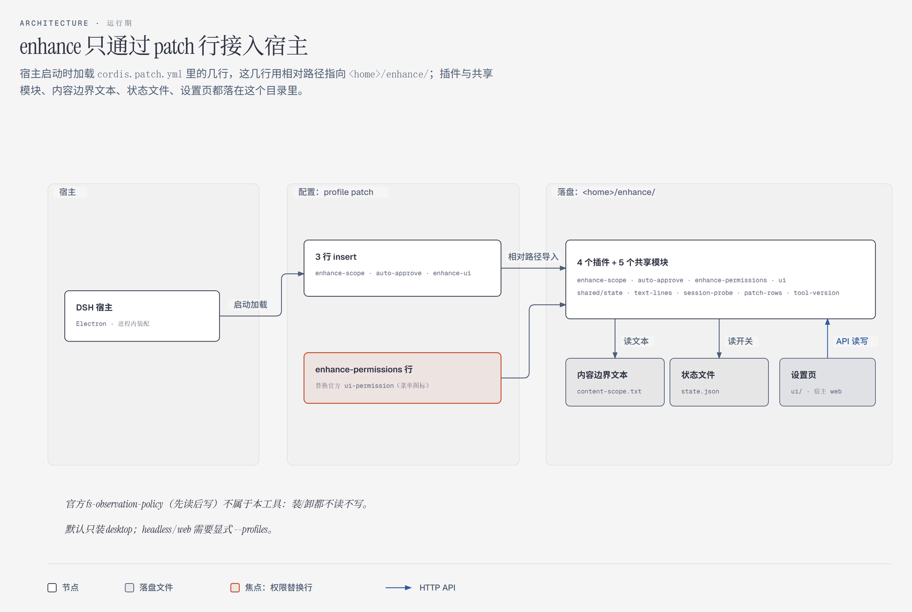
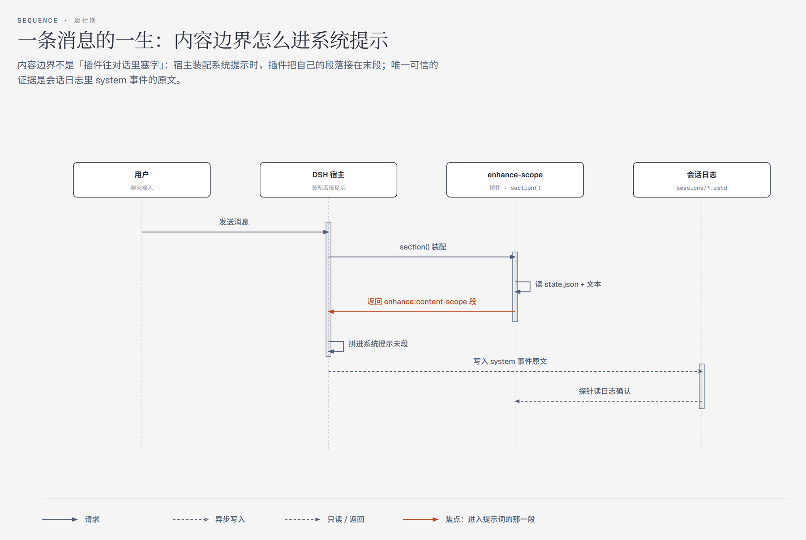
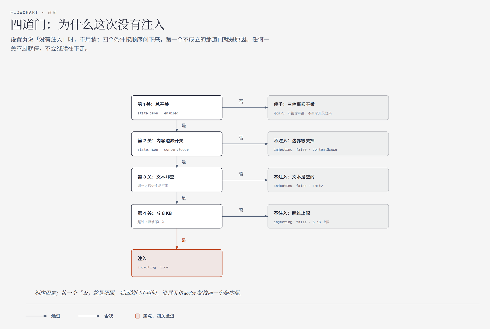
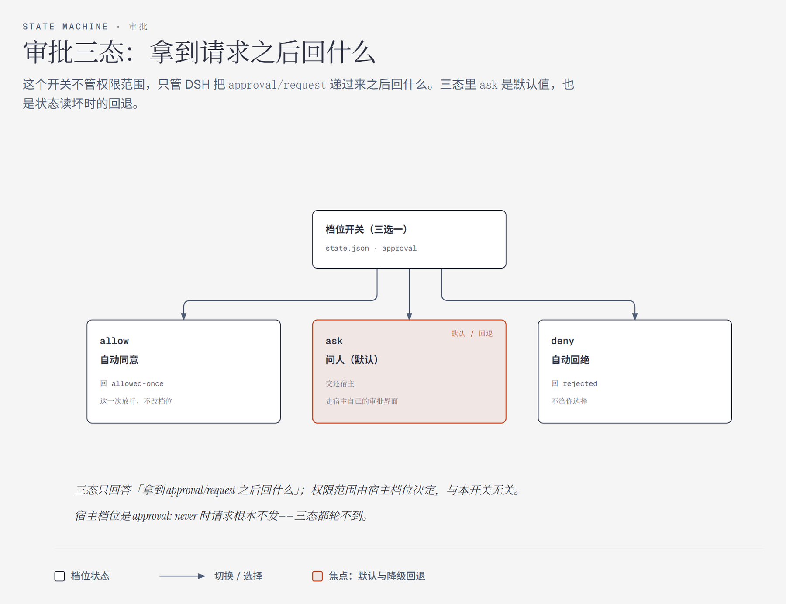

# dsh-enhance

给 DeepSeek Harness 用的小工具：让 DSH 别老说「我不能」。

你写一段话（比如破甲提示词），它会被接在 DSH 原本提示词的后面，每条消息都带上。存盘就生效，下一条消息就按新内容来，不用重启。效果取决于你写的内容和用的模型——工具本身不带提示词，你写什么它就带什么。

它不改 DSH 本身：DSH 的程序、自带的提示词、工具说明、默认说话风格都不动。装的时候只是在 DSH 的配置里加几行「加载这个小工具」的记录；桌面版会把权限菜单换成它的版本。装了什么都有记录，卸载能把 DSH 还原成装之前的样子。

**适用版本**：dsh-enhance `1.0.0` · DeepSeek Harness `0.2.1-rc.3` · Node.js ≥ 22 · 不用装依赖。DSH 升级后先跑一次 `node doctor.mjs --home <DSH_HOME>`；如果权限菜单的图标不对，按下面「升级之后」重新生成一次。

## 它到底改了什么

DSH 的程序和自带提示词不动，改的是它的配置文件，再加上工具自己放在 `<DSH_HOME>/enhance/` 里的文件：

| 改的地方 | 具体做了什么 |
|---|---|
| `<DSH_HOME>/enhance/` | 放这个工具的文件。`state.json`（开关）和 `content-scope.txt`（你写的那段话）只在没有的时候才创建，已经有就不覆盖 |
| DSH 的配置 `cordis.patch.yml` | 加几行记录，让 DSH 开机时加载它；桌面版还会把权限菜单换成它的版本 |
| 权限档位 | 多一个 `enhanced` 档（沙箱全开、审批仍问人）。原来没有默认档位的话，会把默认设成它 |
| 自带的「人格后缀」 | 如果你在配置里写过 `personaSuffix` 或 `suffix` 这段文字，它会被清空——这个位置要让给那段提示词；卸载会还原 |
| 备份 | 每次动配置前先存一份 `.bak-enhance-<时间>`，卸载时按备份还原 |

装之前可以先跑一次 `--dry-run`，上面这些改动作它会逐条打出来，你看一眼再决定装不装。

## 安装

```powershell
git clone https://github.com/wufeng0105/dsh-enhance.git
cd dsh-enhance

node install.mjs --home <DSH_HOME> --dry-run   # 1. 先看会改哪里，不写盘
node install.mjs --home <DSH_HOME>             # 2. 真装
node doctor.mjs  --home <DSH_HOME>             # 3. 全部 PASS 后重启 DeepSeek Harness
```

- `<DSH_HOME>` 是 DSH 的 home，常见是 `%USERPROFILE%\.dsh`。
- 默认只装桌面版；`headless` / `web` 要自己指定（用 `--profiles`，前提是这些版本已经有配置文件）；`--all` 装当前 home 里存在的全部。
- 装完只提示「请重启 DeepSeek Harness」，不会自动重启。
- 不想敲命令：双击仓库根的 `enhance-install.cmd`（中文菜单；加 `-Yes` 不问直接装，加 `-DryRun` 只看不装）。
- 重启后打开 DSH 设置页的 enhance 那一节，点一次「开始检查」，确认真的生效了。

## 使用

改 `<DSH_HOME>/enhance/content-scope.txt` 里那段话：存盘就生效，下一条消息就带上；最多 8 KB（会自动去 BOM、统一换行、去控制字符、去首尾空白）。仓库根目录的那个 `content-scope.txt` 只是第一次装的时候抄进去的默认内容，你的文件已经存在就不会被覆盖。

开关在 `<DSH_HOME>/enhance/state.json`：

| 开关 | 装好时 | 管什么 |
|---|---|---|
| `enabled` | 开 | 关掉 = 全部停下 |
| `contentScope` | 开 | 关掉 = 不注入那段话 |
| `approval` | 自动放行 | 自动放行 / 每次问人 / 直接拒绝；这个文件坏了会回落到「每次问人」 |

**装好时审批是自动放行的**，工具操作不会弹窗。不想这样，就在设置页把它改成「每次问人」或「直接拒绝」。

也可以不管文件，直接去 DSH 设置页的 enhance 那一节：改文本、改开关、点「开始检查」看有没有真的注入、点卸载。

## 卸载

```powershell
node uninstall.mjs --home <DSH_HOME> --dry-run   # 先看计划
node uninstall.mjs --home <DSH_HOME>             # 默认：先归档，再删掉自己装的文件，保留所有备份
node uninstall.mjs --home <DSH_HOME> --thorough  # 彻底清理：不归档，连自己造的备份也一起删
```

默认卸载会把 DSH 的配置还原成装之前的样子，一处不差。不想敲命令：双击 `enhance-uninstall.cmd`，选 `1` 保留备份 / `2` 彻底清理。

## 升级之后

DSH 升级后，先跑一次 `node doctor.mjs --home <DSH_HOME>`。如果设置页里的权限菜单图标不对，按新版本重新生成一次：

```powershell
node enhance-permissions/build-client.mjs --asar "<DSH_ROOT>\resources\app.asar"
```

## 让 AI 帮你装

不想自己敲命令：把下面整段发给任意 AI（Claude / Codex / 你自己的 DSH 会话都行），它会照做。

```text
帮我在这台机器上安装 dsh-enhance —— 一个 DeepSeek Harness 的本地破甲插件。
仓库：https://github.com/wufeng0105/dsh-enhance

要求：
1. 先确认 Node.js ≥ 22，并且本机已经装好 DeepSeek Harness。
2. clone 仓库，先跑 `node install.mjs --home <DSH_HOME> --dry-run`，把输出原样贴给我。
3. 我确认后再跑 `node install.mjs --home <DSH_HOME>`。
4. 然后跑 `node doctor.mjs --home <DSH_HOME>`，把每一行输出原样贴给我。
5. 全部 PASS 后停手，只告诉我「请重启 DeepSeek Harness」；不要自动重启、不要改 DSH 源码、不要动别的插件和配置。

如果我不知道 <DSH_HOME> 是哪，先把 DSH home 找出来告诉我，不要猜。
```

## 图



*运行期架构：它只靠 DSH 配置里的几行记录接进去，不改程序本体。*



*一条消息的一生：你写的那段话怎么进到系统提示里，以及怎么用会话日志证明它真的进去了。*



*四道门：总开关、内容边界开关、文本非空、文本不超过 8 KB——哪道没通过、原因是什么。*



*审批三态：自动放行 / 每次问人 / 直接拒绝分别是什么结果，以及开关文件坏了为什么回落到「每次问人」。*

## 许可

[MIT](LICENSE)
